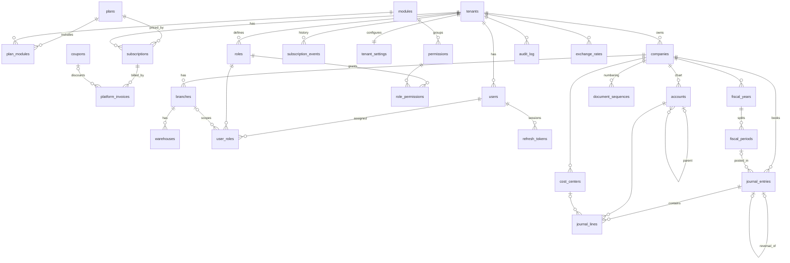

# Database — ERD & Data Dictionary

Source of truth: `server/db/migrations/*.sql` (forward-only, checksummed; a modified applied migration aborts the run).

## 1. ERD (implemented tables)

## 2. Conventions

* **PK** `uuid` (`gen_random_uuid()`), except logs (`bigserial`).
* **Tenant ownership:** `tenant_id uuid NOT NULL`, `UNIQUE (tenant_id, id)` on parents, **composite FKs** on children.
* **RLS:** `ENABLE` + `FORCE`, policy `p_tenant_isolation` = `tenant_id = app_tenant_id()`.
* **Money:** `numeric(20,4)` in the ledger (base currency), `numeric(14,3)` for subscription prices; never floating point. Amounts are returned to clients as **strings**.
* **Rounding:** base amount = `round(amount_fc × fx_rate, currency.minor_units)` computed **in SQL** (LYD = 3).
* **Timestamps:** `timestamptz`; `updated_at` maintained by trigger `set_updated_at()`.
* **Soft delete:** master data uses `is_active` (deactivate, never delete referenced rows). Financial documents are never deleted once posted.
* **JSON** is used only for audit snapshots (`before_data`/`after_data`), never for core relational data.

## 3. Data dictionary

### Global catalogs (read-only to the app)
| Table | Purpose | Key columns / rules |
|---|---|---|
| `currencies` | ISO currencies | `code char(3)` PK, `minor_units` 0–4 (LYD=3) |
| `modules` | Product modules (18) | `code` PK — used for plan gating |
| `permissions` | Permission catalog | `code` like `accounting.journal.post`; `is_sensitive` excludes it from `*.view` wildcards |

### Platform scope
| Table | Purpose | Rules |
|---|---|---|
| `platform_users` | SaaS owner staff | separate from tenant users; RLS platform-only; optional TOTP |
| `plans` | Commercial plans | limits: users, companies, branches, warehouses, storage, API rpm; trial & grace days |
| `plan_modules` | Modules per plan | PK (plan, module) |
| `tenants` | Customer companies | `code` unique slug; `status` trial/active/past_due/suspended/cancelled; base currency, timezone, locales, `is_demo`, branding |
| `subscriptions` | Plan contracts | **partial unique index: one live subscription per tenant**; `superseded` on plan change |
| `subscription_events` | Lifecycle history | append-only for the app |
| `platform_invoices` | Subscription invoices | number `PINV-YYYY-NNNNNN` from a sequence; `discount ≤ amount` |
| `coupons` | Discount codes | redemption counter can't exceed max (CHECK) |

### Tenant scope
| Table | Purpose | Rules |
|---|---|---|
| `tenant_settings` | Security & format policy | SoD on/off (default **on**), MFA required, password min length, lockout threshold, fiscal start month |
| `companies` | Legal entities inside a tenant | unique code per tenant; base currency |
| `branches` | Head office / factory / branch / site | kind enum; FK to company |
| `warehouses` | Storage locations | kinds incl. `quarantine`, `damaged`, `van`; **CHECK: quarantine/damaged can never be sellable** |
| `users` | Tenant users | unique email per tenant; bcrypt hash; lockout counters; TOTP |
| `roles` / `role_permissions` | RBAC | 18 system roles seeded and re-synced; custom roles allowed |
| `user_roles` | Assignments | optional `branch_id` scope; unique per (user, role, branch) |
| `refresh_tokens` | Sessions | SHA-256 hash only; `family_id` for reuse detection |
| `login_attempts` | Security log | every success/failure with reason and IP |
| `audit_log` | Audit trail | **append-only (trigger + privileges)**; tenant sees own; platform sees only platform-level events |
| `idempotency_keys` | Safe retries | PK (tenant, key); stores status + response |
| `document_sequences` | Gap-free numbering | row-locked counter per (company, doc type-year) |
| `accounts` | Chart of accounts | unique code per company; `is_postable` leaf; `role` tag (unique per company) for integrations; normal balance incl. contra accounts |
| `cost_centers` | Analytical dimension | hierarchical |
| `fiscal_years` / `fiscal_periods` | Calendar | **EXCLUDE constraints: no overlapping years/periods per company**; period close blocked while drafts exist |
| `exchange_rates` | FX | unique per (tenant, from, to, date); rate > 0 |
| `journal_entries` | Journal header | `draft → posted → reversed`; number assigned at posting; `(company, source_type, source_id)` unique for live entries; reversal at most once |
| `journal_lines` | Journal lines | **CHECK: exactly one of debit/credit > 0**; base amounts + original currency amount + rate |

### Integrity triggers (GL)
| Trigger | Guarantees |
|---|---|
| `trg_gl_validate_posting` (deferred constraint) | At commit: ≥2 lines, **Σdebit = Σcredit**, accounts postable/active/same company, date inside an **open** assigned period |
| `trg_gl_entry_guard` | Posted entries immutable; only posted→reversed allowed; posted/reversed never deleted |
| `trg_gl_lines_guard` | Lines of non-draft entries cannot be inserted/updated/deleted |
| `trg_gl_period_close_guard` | Cannot close a period containing drafts |
| `trg_audit_append_only` | Audit rows cannot be updated or deleted |
