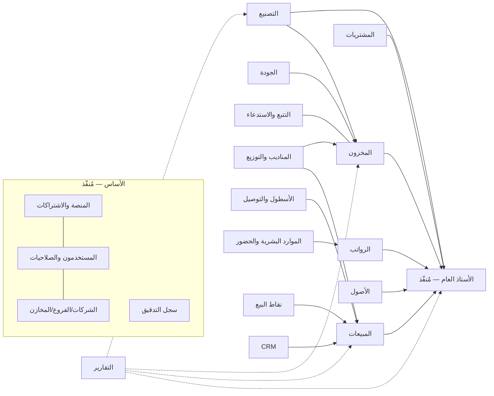
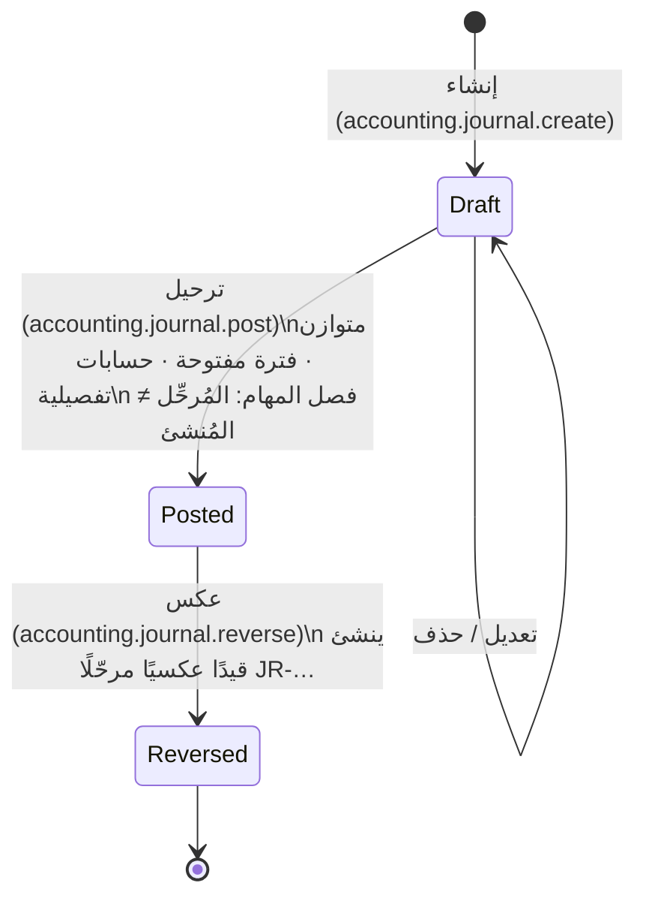

# خريطة الوحدات والتكاملات وسير العمل

## 1. خريطة الوحدات

## 2. نموذج الحالات الموحد للمستندات

| الحالة | المعنى | الأثر |
|---|---|---|
| **مسودة** (Draft) | محفوظ وقابل للتعديل والحذف | لا أثر على المخزون أو الحسابات |
| **مُعتمد** (Approved) | اعتمده مستخدم آخر غير المُنشئ (عند تفعيل فصل المهام) | قد يحجز (مثل حجز كمية لأمر البيع) |
| **مُرحّل/منفّذ** (Posted) | أثره نهائي | حركة مخزون + قيد محاسبي **في نفس المعاملة** — غير قابل للتعديل |
| **ملغى بعكس** (Reversed) | تصحيح موثّق بمستند عكسي | المستند الأصلي يبقى، والعكسي يُلغي أثره |

## 3. التكاملات الإلزامية (§10) — متى يحدث كل أثر

| # | العملية | الحفظ | الاعتماد | الترحيل (الأثر) | القيد المحاسبي (حسب أدوار الحسابات) | الحالة |
|---|---|---|---|---|---|---|
| 1 | أمر بيع يحجز المخزون | مسودة | اعتماد الأمر → **حجز** حسب السياسة | — | لا قيد | مخطط (المرحلة 2b) |
| 2 | تسليم المبيعات | — | — | إذن تسليم → خصم المخزون | مدين `cogs` / دائن `inventory_fg` (أو `inventory_van`) | مخطط |
| 3 | فاتورة المبيعات | مسودة | — | ترحيل | مدين `ar` (أو `cash_main`) / دائن `sales_revenue` (+ `tax_payable`) | مخطط — **العقد `postFromSource` جاهز ومُختبر** |
| 4 | التحصيل | سند قبض | — | ترحيل | مدين `cash_main`/`bank_main`/`rep_cash_custody` / دائن `ar` | مخطط |
| 5 | طلب الإنتاج يحسب الاحتياجات | أمر تشغيل | تحرير → حساب BOM × الكمية − المتاح | — | — | مخطط (3) |
| 6 | صرف المواد | إذن صرف | — | خصم مواد خام | مدين `inventory_wip` / دائن `inventory_raw`, `inventory_packaging` | مخطط |
| 7 | استلام الإنتاج | إذن استلام | — | إضافة منتج تام (بحالة حجر حتى إفراج الجودة) | مدين `inventory_quarantine`→`inventory_fg` / دائن `inventory_wip` | مخطط |
| 8 | التكلفة الفعلية | إغلاق أمر التشغيل | — | فرق فعلي/معياري | `production_variance`, `production_scrap`, `overhead_absorbed` | مخطط |
| 9 | استلام مشتريات | إذن استلام | فحص الجودة | إضافة مخزون | مدين `inventory_raw` / دائن `grni` | مخطط |
| 10 | فاتورة المورد | مسودة | اعتماد (مطابقة ثلاثية PO/GRN/Invoice) | ترحيل | مدين `grni` (+ فروق) / دائن `ap` | مخطط |
| 11 | الرواتب | مسير | اعتماد مدير الموارد البشرية + المالي | ترحيل | مدين `salaries_expense`/`direct_labour` / دائن `salaries_payable`, `payroll_deductions_payable`, `employee_advances` | مخطط (5) |
| 12 | الحضور يغذي الرواتب | — | إقفال شهر الحضور | — | — | مخطط — إعادة استخدام `engine.ts` |
| 13 | المندوب: طلب وتحصيل | من التطبيق (offline + Idempotency-Key) | حسب الصلاحية | — | عبر 3 و 4 | مخطط (4) |
| 14 | التوزيع يحدث التسليم | — | — | إثبات تسليم (توقيع/صورة) | — | مخطط |
| 15 | مرتجع العميل | مسودة | — | **إلى مخزن الحجر** | مدين `sales_returns` / دائن `ar`؛ مدين `inventory_quarantine` / دائن `cogs` | مخطط |
| 16 | لا عودة للمخزون الصالح دون فحص | — | قرار الجودة: إفراج أو إتلاف | تحويل حجر → صالح أو → تالف | إتلاف: مدين `production_scrap` / دائن `inventory_quarantine` | **القاعدة مفروضة الآن بقيد DB: مخزن الحجر لا يمكن أن يكون قابلًا للبيع** |

## 4. سير عمل المحاسبة المنفذ حاليًا

